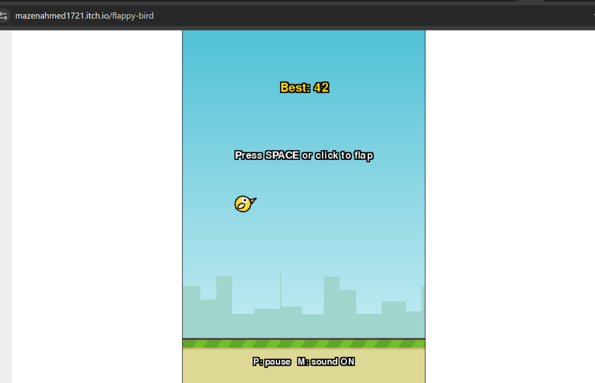

# Flappy-Bird

its a 2D Flappy Bird game built with Python and Pygame

## Description

I built flappy bird as an arcade game where you can control the bird to avoid the pipes by jumping, the goal is to get the highest score by surviving more
the game was built using Python and Pygame and converted into a browser-playable version using Pygbag

## Demo

[Play Flappy Bird](https://mazenahmed1721.itch.io/flappy-bird)

## Screenshots



## getting started
 
### Dependencies

- Python 3
- Pygame-ce
- pygbag (for the browser version)

### Installing 

Clone or download the repo then open its folder in vscode.

then Install the dependencies:

```bash
py -m pip install pygame-ce pygbag
```

### Executing Program 

**Run locally:**

```bash
py main.py
```

**Run in the browser localle:**

```bash
py -m pygbag .
```
Then open `http://localhost:8000` in your browser